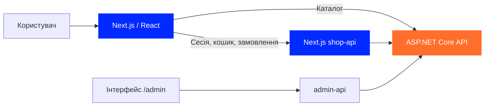

<div align="center">

# Treba Frontend

### Інтерфейс маркетплейсу · кабінет покупця · адміністративний простір

[English](README.en.md) · **Українська**


<br>

   

[](https://github.com/tr3ba/treba-frontend)
[](https://github.com/tr3ba/treba-backend)
[](https://github.com/tr3ba/.github/blob/main/README.uk.md)

</div>

## Навігація

[Можливості](#frontend-about) · [Версії](#frontend-stack) · [API та стан](#frontend-api) · [Запуск](#frontend-run) · [Перевірки](#frontend-checks) · [Docker і доставка](#frontend-delivery) · [Документація](#frontend-docs)

---

<a id="frontend-about"></a>

## Що робить frontend

Treba Frontend: Next.js-інтерфейс маркетплейсу. Він містить магазин і адміністративний простір та звертається до окремого backend API.

<table width="100%">
<tr>
<td width="460" valign="top">

### Покупцю

- Каталог, категорії й сторінки товарів.
- Пошук, галерея та порівняння товарів.
- Реєстрація, вхід і відновлення доступу.
- Кошик, оформлення й скасування замовлення, доставка.
- Бажання, відгуки та приватна підтримка.

</td>
<td width="460" valign="top">

### Продавцю та адміністрації

- Адміністративний простір `/admin`.
- Заявки продавців та інструменти імпорту.
- Модерація товарів, відгуків і звернень.
- Керування доступними адміністративними сценаріями.
- UK/EN-перемикання адміністративного інтерфейсу.

</td>
</tr>
</table>

Магазин, кошик і `/admin` використовують різні маршрути API. Нижче показано, які дані надходять із backend, а що зберігається в браузері.

<a id="frontend-stack"></a>

## Технології та версії

| Компонент | Версія / конфігурація |
|---|---|
| Next.js | `16.2.12` |
| React / React DOM | `19.2.4` |
| TypeScript | `^5` у package.json |
| Стилі | CSS та CSS modules |
| ESLint | `^9`; `eslint-config-next 16.2.12` |
| Node.js у frontend CI | `22` |
| Node.js у Docker | `24-alpine` |
| Типи Node.js | `@types/node ^20` |

Конфігурація: [package.json](https://github.com/tr3ba/treba-frontend/blob/89e6cdb54892466b11fa0c564a42a4d17089546d/package.json), [Frontend Checks](https://github.com/tr3ba/treba-frontend/blob/89e6cdb54892466b11fa0c564a42a4d17089546d/.github/workflows/check-frontend.yml), [Dockerfile](https://github.com/tr3ba/treba-frontend/blob/89e6cdb54892466b11fa0c564a42a4d17089546d/docker/Dockerfile.frontend).

У CI використовується Node.js 22, у Docker-образі Node.js 24.

<a id="frontend-api"></a>

## Як frontend працює з API



| Сценарій | Як реалізовано |
|---|---|
| Товари й категорії | Запити до backend API через модулі `src/lib/api` |
| Сесія покупця | Next.js маршрути й HttpOnly cookies; backend перевіряє облікові дані |
| Кошик після входу | Proxy `/shop-api/cart` звертається до backend; підтримується перенесення гостьових позицій із обробкою помилок |
| Гостьовий кошик | Залишається у браузері до входу |
| Замовлення | Серверний маршрут Next.js передає автентифікований запит до API; скасування замовлення покупцем додано у [PR #56](https://github.com/tr3ba/treba-frontend/pull/56) |
| Переглянуті товари | Історія зберігається в localStorage |
| Порівняння | Вибірки каталогу та клієнтські списки; у product-модулі є TODO для backend API списків |

Для сесій застосунок використовує HttpOnly і SameSite cookies; у production також Secure.

Файли реалізації: [products.ts](https://github.com/tr3ba/treba-frontend/blob/89e6cdb54892466b11fa0c564a42a4d17089546d/src/lib/api/products.ts), [categories.ts](https://github.com/tr3ba/treba-frontend/blob/89e6cdb54892466b11fa0c564a42a4d17089546d/src/lib/api/categories.ts), [CartContext](https://github.com/tr3ba/treba-frontend/blob/89e6cdb54892466b11fa0c564a42a4d17089546d/src/context/CartContext.tsx), [серверна сесія](https://github.com/tr3ba/treba-frontend/blob/89e6cdb54892466b11fa0c564a42a4d17089546d/src/lib/server/session.ts), [замовлення](https://github.com/tr3ba/treba-frontend/blob/89e6cdb54892466b11fa0c564a42a4d17089546d/src/app/shop-api/orders/route.ts).

### Межі каталогу

У `products.ts` частина добірок бере перші **100 товарів**. «Кращі пропозиції» та рекомендації формуються з цієї вибірки, тому їхній склад залежить від порядку товарів у відповіді API.

<a id="frontend-run"></a>

## Локальний запуск вихідного коду

Команди виконуються в корені **tr3ba/treba-frontend**. Потрібні Node.js/npm та доступний backend, якщо перевіряються API-сценарії.

### 1. Установити залежності

```powershell
npm ci
Copy-Item .env.example .env.local
```

Для відтворення frontend checks використовується Node.js 22. Docker збирається на Node.js 24; це окремий шлях виконання.

### 2. Указати локальні адреси

Приклад `.env.local` для локального backend на порту 5000:

```dotenv
NEXT_PUBLIC_API_URL=http://localhost:5000
TREBA_API_URL=http://localhost:5000
TREBA_STORE_ORIGIN=http://localhost:3000
```

| Змінна | Роль |
|---|---|
| `NEXT_PUBLIC_API_URL` | Публічна адреса API для модулів, які її читають |
| `TREBA_API_URL` | Адреса backend, яку серверний session-модуль читає через process.env |
| `TREBA_STORE_ORIGIN` | Origin магазину для серверних сценаріїв |
| `DEV_ALLOWED_ORIGINS` | За потреби: адреси доступу до dev-сервера з інших пристроїв |

У [серверному session-модулі](https://github.com/tr3ba/treba-frontend/blob/89e6cdb54892466b11fa0c564a42a4d17089546d/src/lib/server/session.ts) адреса вибирається в порядку `TREBA_API_URL → NEXT_PUBLIC_API_URL → https://treba.duckdns.org`. Тому для локального запуску задайте адреси явно.

Параметри описані в [.env.example](https://github.com/tr3ba/treba-frontend/blob/89e6cdb54892466b11fa0c564a42a4d17089546d/.env.example) і [next.config.ts](https://github.com/tr3ba/treba-frontend/blob/89e6cdb54892466b11fa0c564a42a4d17089546d/next.config.ts). Змінні `NEXT_PUBLIC_*` публічні: в них не розміщують ключі OAuth, SMTP чи інші серверні секрети.

### 3. Запустити frontend

```powershell
npm run dev
```

Магазин: [localhost:3000](http://localhost:3000). Адміністративний простір: [localhost:3000/admin](http://localhost:3000/admin).

Відкриття `/admin` не надає адміністративних прав: відповідні ролі й автентифікація залежать від backend.

### Перевірка production-збірки локально

```powershell
npm run build
npm run start
```

`npm run start` очікує вже створену Next.js-збірку. Адреси API, доступ до зображень і авторизовані сценарії треба перевіряти окремо; успіх build не підтверджує їхню роботу.

<a id="frontend-checks"></a>

## Перевірки та тести

| Команда | Для чого |
|---|---|
| `npm run lint` | ESLint; script є в package.json |
| `npx tsc --noEmit` | Перевірка типів |
| `npm run build` | Next.js build |
| `node --test tests/*.test.mjs` | Node-тести з frontend workflow |
| `python3 -m unittest discover -s tests -p 'test_*.py'` | Python-тести з frontend workflow |

У `package.json` немає script `test`, тому не пропонуємо `npm test`. Команда `python3` вище взята з Linux runner GitHub Actions; локально потрібен доступний Python і відповідне ім'я executable.

[Frontend Checks](https://github.com/tr3ba/treba-frontend/blob/89e6cdb54892466b11fa0c564a42a4d17089546d/.github/workflows/check-frontend.yml) запускає встановлення залежностей, TypeScript check, build, Node-тести й Python unittest. ESLint script існує окремо; у прочитаному Checks workflow немає кроку `npm run lint`.


<a id="frontend-delivery"></a>

## Docker і доставка

Dockerfile використовує окремі stages `deps → builder → runner`; runtime: Node.js 24 Alpine, порт 3000.

```powershell
docker build -f docker/Dockerfile.frontend --build-arg NEXT_PUBLIC_API_URL=http://localhost:5000 -t treba-frontend:local .
```

Це приклад збірки з публічною адресою локального API. Для запуску серверні proxy-маршрути мають окремо отримати адресу backend, досяжну **з контейнера**, через `TREBA_API_URL`. `localhost` усередині контейнера позначає сам контейнер.

`NEXT_PUBLIC_*` передаються на етапі build, тому зміна лише runtime environment не означає оновлення вже вбудованих значень.

### Шлях CI/CD

```text
Frontend Checks
      ↓
Перевірки storefront/workspace → Docker image → Amazon ECR
      ↓
AWS Systems Manager → candidate → EC2 / HTTP-перевірки
```

Після перевірок Docker-образ публікується в ECR. Deployment-скрипт бере образ за SHA-тегом, перевіряє новий контейнер і зберігає попередній для повернення при помилці.

[Docker publish](https://github.com/tr3ba/treba-frontend/blob/89e6cdb54892466b11fa0c564a42a4d17089546d/.github/workflows/docker-publish.yml) · [Deploy workflow](https://github.com/tr3ba/treba-frontend/blob/89e6cdb54892466b11fa0c564a42a4d17089546d/.github/workflows/deploy-frontend.yml) · [Deployment script](https://github.com/tr3ba/treba-frontend/blob/89e6cdb54892466b11fa0c564a42a4d17089546d/scripts/deploy-frontend.sh)

<details>
<summary><strong>Окремий Stage 5</strong></summary>

Stage 5 містить окрему frontend ECR-збірку. Kubernetes-матеріали цього експериментального напряму зберігаються в backend.

[Stage 5 workflow](https://github.com/tr3ba/treba-frontend/blob/89e6cdb54892466b11fa0c564a42a4d17089546d/.github/workflows/stage5-frontend-ecr.yml).

</details>

<a id="frontend-docs"></a>

## Структура та документація

```text
src/
├── app/          сторінки й серверні маршрути Next.js
├── components/   компоненти інтерфейсу
├── context/      стан і взаємодія клієнтських сценаріїв
└── lib/          API-модулі та серверні допоміжні функції

docker/           Dockerfile.frontend
tests/            Node- і Python-перевірки
.github/workflows/ CI, публікація й доставка
```

| Напрям | Документ у вихідному репозиторії |
|---|---|
| Адміністративний простір | [Admin workspace](https://github.com/tr3ba/treba-frontend/blob/89e6cdb54892466b11fa0c564a42a4d17089546d/docs/admin-workspace.md) |
| Сесії й підтримка | [Support](https://github.com/tr3ba/treba-frontend/blob/89e6cdb54892466b11fa0c564a42a4d17089546d/docs/support.md) |
| Реєстрація | [Верифікація](https://github.com/tr3ba/treba-frontend/blob/89e6cdb54892466b11fa0c564a42a4d17089546d/docs/registration-verification.md) |
| Google / Facebook | [Зовнішня авторизація](https://github.com/tr3ba/treba-frontend/blob/89e6cdb54892466b11fa0c564a42a4d17089546d/docs/external-authentication.md) |
| Сценарії маркетплейсу | [Marketplace workflows](https://github.com/tr3ba/treba-frontend/blob/89e6cdb54892466b11fa0c564a42a4d17089546d/docs/marketplace-workflows.md) |

---

[Backend README](https://github.com/tr3ba/treba-backend#readme) · [Історія TREBA](https://github.com/tr3ba/.github/blob/main/docs/history/project-history.md) · [Команда](https://github.com/tr3ba/.github/blob/main/docs/team/README.md)
